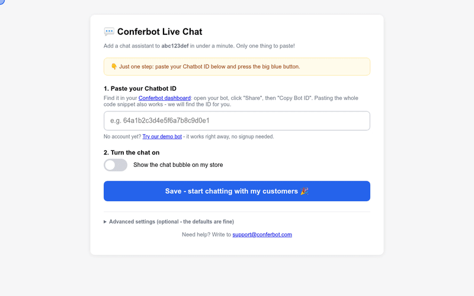

# Conferbot BigCommerce App

Installs the [Conferbot](https://conferbot.com) AI chat widget on a BigCommerce storefront. Same product as the [Shopify app](https://github.com/Conferbot/conferbot-shopify), BigCommerce-shaped: OAuth install callback, signed-payload load/uninstall callbacks, and a storefront Script (Scripts API v3) that serves a per-store widget loader.

## See it in action

Paste the Chatbot ID in the app settings, save, and the chat is live (recorded against the mock storefront from the e2e suite):



[HD video (MP4)](docs/demo.mp4)

## How it works

```
merchant installs from the marketplace
  -> BigCommerce calls GET /auth?code&scope&context
  -> code exchanged at login.bigcommerce.com/oauth2/token
  -> Script registered: src = {APP_URL}/script.js?store={hash}
     (auto_uninstall: true, async, all_pages)
  -> merchant lands on /app (settings: paste bot ID, flip switch)

merchant opens the app later     -> GET /load?signed_payload_jwt   (HS256-verified)
merchant uninstalls              -> GET /uninstall?signed_payload_jwt (record removed)

every storefront page load
  -> BigCommerce injects the Script
  -> loader boots window.ConferbotWidget(botId, embedType,
       { customData: { platform: "bigcommerce", storeHash }, user? })
```

The only merchant-facing setting is the **Chatbot ID** (bare ID, full snippet, or URL - auto-extracted), with a one-click **demo bot** (`691c970890527a0468f9b2c9`) that works without a Conferbot account.

The settings page opens only from BigCommerce's signed install and load callbacks, which hand over a short-lived token signed with the client secret; every save carries one too. A bare `?store=` is refused.

Everything visitors see is set per bot in the Conferbot dashboard and delivered at runtime, with nothing to configure in the store: flows and AI agents, live chat with handover to your team (queue position, leave a message when nobody is free, read receipts, file sharing, post-chat rating), the home screen, themes and dark mode, colours, launcher and mascot, greetings, languages and disabled URLs.

## Project layout

```
src/
├── index.js         # entrypoint
├── server.js        # /auth, /load, /uninstall, /app, /app/save, /script.js
├── config.js        # env-driven config (BC_AUTH_BASE/BC_API_BASE overridable for tests)
├── bigcommerce.js   # token exchange, signed_payload_jwt verify, Scripts API
├── widgetScript.js  # per-store loader generation (script-context-safe JSON)
├── adminPage.js     # two-step settings page
└── store.js         # JSON-file store (swap for a real DB behind the same interface)
test/e2e.test.js     # helpers + full journey against a mock BigCommerce + browser mount
```

## Setup

1. Create a draft app in the [BigCommerce Developer Portal](https://devtools.bigcommerce.com): set the Auth callback to `{APP_URL}/auth`, Load callback to `{APP_URL}/load`, Uninstall callback to `{APP_URL}/uninstall`. Request the `Content: modify` scope (Scripts API).
2. Copy `.env.example` to `.env` with the client ID/secret. `APP_URL` must be public HTTPS.
3. `npm install && npm start`, then install the draft app on your sandbox store from the dev portal.

## Tests

```bash
npm test                    # helpers + full install/load/save/uninstall journey (mock BigCommerce)
RUN_BROWSER_E2E=1 npm test  # + headless Chrome: the real CDN widget mounts on a fake storefront
```

12 tests cover: store-hash extraction/validation, signed-payload JWT verification (valid, wrong secret, expired, malformed), install token exchange, Script registration idempotency on reinstall, settings save with full-snippet paste, loader no-op before configuration, uninstall cleanup, and the browser mount.

## Production checklist (before marketplace submission)

- [ ] Real database behind the store record interface
- [x] Settings tied to the store's admin (signed tokens from the install and load callbacks)
- [ ] Marketplace listing assets (see the submission guide)

## License

MIT.
